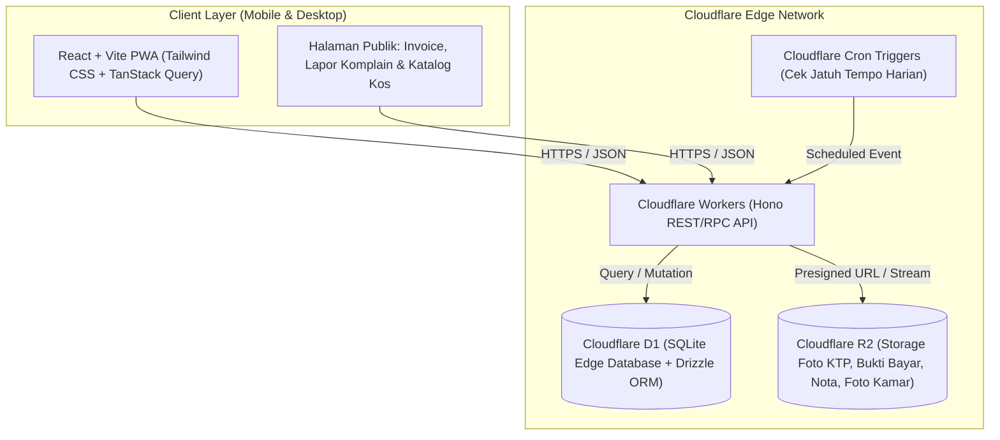

# Product & Technical Plan: SaaS Manajemen Kos Malang (Cloudflare PWA)

Dokumen perencanaan produk dan arsitektur teknis untuk aplikasi web **Progressive Web App (PWA) SaaS Manajemen Kos** yang dirancang khusus menjawab masalah nyata pemilik dan penjaga kos di **Kota Malang** (kawasan UB, UM, Polinema, UMM, Binus, dll.), di-deploy sepenuhnya di ekosistem **Cloudflare Edge**.

---

## 1. Konteks Lokal & Masalah Utama Pemilik Kos di Malang

Karakteristik pengelolaan kos di Kota Malang (seperti area Soekarno-Hatta, Sigura-gura, Sumbersari, Watugong, Merjosari, Dinoyo, hingga Landungsari/Tegalgondo) memiliki keunikan tersendiri dibanding kota lain:

1. **Siklus Sewa Campuran (Tidak Hanya Bulanan):** Banyak kos mahasiswa di Malang menerapkan sewa **Semesteran (6 bulan)** atau **Tahunan** untuk mahasiswa baru, namun berubah menjadi **Bulanan** atau **3 Bulanan** saat mahasiswa tingkat akhir. Pencatatan di buku tulis atau Excel sering membuat pemilik lupa siapa yang jatuh tempo bulan ini.
2. **Komunikasi Berbasis WhatsApp & Transfer Manual:** Mayoritas juragan kos di Malang lebih nyaman menerima uang via transfer bank/QRIS statis langsung ke rekening pribadi mereka (tanpa potongan *fee* Payment Gateway per transaksi), tetapi lelah harus mengetik pesan pengingat satu per satu, mengecek bukti transfer, dan membuat kwitansi.
3. **Delegasi ke Penjaga Kos:** Banyak pemilik kos memiliki lebih dari satu properti (misal Kos Putra di Sigura-gura & Kos Putri di Suhat) dan mempekerjakan penjaga kos. Pemilik butuh penjaga untuk mengurus operasional harian (input penghuni, cek kamar, catat pengeluaran, tangani komplain) **tanpa** memperlihatkan total omzet dan laba bersih ke penjaga.
4. **Biaya Tambahan & Deposit yang Sering Tercecer:** Biaya sekamar berdua, parkir mobil, iuran sampah/WiFi, denda keterlambatan, serta uang deposit/jaminan kunci saat *check-in* sering lupa dicatat atau dipotong saat penghuni *check-out*.
5. **Komplain Fasilitas Tidak Terlacak:** laporan "kran bocor", "token habis", atau "WiFi mati" tenggelam di chat WA grup atau japri.

---

## 2. Solusi & Fitur Utama (MVP Scope)

Aplikasi berfokus pada **kemudahan penggunaan (ramah pemilik kos usia 35–60+ tahun)**, ringan diakses dari HP sebagai PWA (bisa di-*install* ke layar utama HP seperti aplikasi native), dan langsung menyelesaikan 7 masalah inti:

### A. Multi-Properti & Manajemen Kamar
- **Multi-Cabang Kos:** 1 akun pemilik dapat mengelola beberapa lokasi kos (contoh: *Kos Melati 1 - Suhat*, *Kos Melati 2 - Landungsari*).
- **Tipe & Harga Fleksibel per Kamar:** Mendukung tarif dasar untuk siklus Bulanan, 3 Bulanan, Semesteran (6 Bulan), dan Tahunan per kamar.
- **Status Kamar Visual:** Filter cepat kamar `Terisi`, `Kosong`, `Sedang Diperbaiki`, atau `Segera Habis Kontrak (< 14 hari)`.

### B. Data Penghuni, Kontrak Sewa & Deposit
- **Onboarding Penghuni Cepat:** Input nama, nomor WA aktif, kampus/instansi, kontak darurat (orang tua/wali — krusial untuk kos mahasiswa Malang), serta upload foto KTP (disimpan aman di Cloudflare R2).
- **Pencatatan Deposit (Uang Jaminan):** Mencatat nominal deposit saat masuk dan status penyelesaiannya saat *check-out* (dikembalikan penuh, dipotong kerusakan/tunggakan).
- **Riwayat Sewa & Pindah Kamar:** Melacak histori penghuni per kamar.

### C. Tagihan (Invoicing), Biaya Tambahan & Pengingat WA
- **Generate Tagihan Otomatis:** Cron job harian di Cloudflare memeriksa kontrak sewa yang akan jatuh tempo (H-7, H-3, Hari-H, H+3) dan menyiapkan draf tagihan.
- **Komponen Tagihan Dinamis:** Sewa pokok + biaya tambahan fleksibel (tambahan orang ke-2, parkir mobil, listrik/air, iuran kebersihan, atau denda keterlambatan) + potongan diskon.
- **Public Invoice Link (Tanpa Login Penghuni):** Setiap tagihan punya tautan unik (`/inv/:token`) berisi rincian tagihan, info rekening/QRIS pemilik kos, dan tombol **"Upload Bukti Bayar"**.
- **Pengingat WhatsApp 1-Klik & Semi-Otomatis:**
  - *Mode Gratis/Dasar:* Tombol 1-klik membuka `wa.me` dengan teks template sopan yang sudah terisi otomatis (nama penghuni, kamar, nominal, jatuh tempo, dan link tagihan).
  - *Mode Pro (Opsional):* Integrasi webhook WhatsApp API pihak ketiga lokal (seperti Fonnte/Wablas) untuk kirim pengingat otomatis di latar belakang.

### D. Konfirmasi Pembayaran & Kwitansi Digital (PDF/Image)
- **Verifikasi Bukti Transfer:** Saat penghuni mengunggah foto bukti bayar dari link tagihan, pemilik/penjaga mendapat notifikasi di dashboard dan cukup klik **"Konfirmasi Lunas"** (atau dukung pembayaran dicicil/DP).
- **Kwitansi Digital Resmi:** Otomatis menghasilkan kwitansi digital berstempel nama kos yang bisa diunduh (PDF/Gambar) atau dikirim balik ke WA penghuni dalam 1 klik.

### E. Tiket Komplain & Perbaikan Fasilitas (Tanpa Login Penghuni)
- **Link/QR Code Lapor Kerusakan:** Pemilik cukup menempel QR Code di lorong kos atau membagikan link (`/lapor/:slug-kos`).
- Penghuni memilih nomor kamar, menulis keluhan (misal: *"Kamar 12 lampu kamar mandi mati"*), dan melampirkan foto.
- Status tiket dilacak oleh pemilik & penjaga: `Baru` -> `Diproses` -> `Selesai` (bisa langsung dihubungkan ke pencatatan biaya pengeluaran jika keluar biaya tukang).

### F. Pencatatan Pengeluaran & Laporan Kas Bersih
- **Jurnal Pengeluaran:** Catat biaya operasional per properti (token listrik koridor, air PDAM, WiFi Indihome/Biznet, gaji penjaga, biaya tukang, sedot WC) beserta foto nota.
- **Dashboard Laba Bersih (Khusus Pemilik):** Ringkasan pemasukan tertagih, piutang belum dibayar (tunggakan), pengeluaran bulanan, dan kas bersih per kos maupun gabungan.

### G. Katalog Publik Kos Sederhana (Mini Microsite)
- Halaman publik ringan (`/kos/:slug-kos`) yang menampilkan nama kos, area (misal: *5 menit dari Gerbang Veteran UB*), fasilitas, daftar kamar yang **sedang kosong** beserta foto & harga, serta tombol **"Tanya via WhatsApp"**.
- Sangat membantu pemilik kos saat membagikan info kamar kosong di grup WA, Instagram, atau Facebook Info Kos Malang tanpa perlu mengetik ulang spesifikasi kamar.

---

## 3. Role & Hak Akses (RBAC)

| Fitur / Akses | Pemilik Kos (Owner) | Penjaga Kos (Staff) | Penghuni / Calon Penghuni |
| :--- | :---: | :---: | :---: |
| Kelola Multi-Properti & Tambah Kamar | ✅ | ❌ (Hanya kos yang ditugaskan) | ❌ |
| Lihat & Input Data Penghuni + KTP | ✅ | ✅ | ❌ |
| Buat Tagihan & Kirim Pengingat WA | ✅ | ✅ | ❌ |
| Lihat & Upload Bukti Bayar Tagihan | ✅ | ✅ | ✅ (Via Link Unik `/inv/:token`) |
| Konfirmasi Lunas & Terbitkan Kwitansi | ✅ | ✅ (Dibatasi/Log tercatat) | ❌ |
| Input Pengeluaran Operasional Harian | ✅ | ✅ | ❌ |
| Kelola Tiket Komplain Kerusakan | ✅ | ✅ | ✅ (Lapor via `/lapor/:slug`) |
| **Laporan Total Omzet & Laba Bersih** | ✅ | ❌ **(Disembunyikan)** | ❌ |
| Kelola Langganan SaaS & Staf Penjaga | ✅ | ❌ | ❌ |

---

## 4. Skema Monetisasi SaaS (Freemium)

Dirancang agar pemilik kos kecil bisa langsung mencoba tanpa hambatan, dan pemilik kos menengah-besar rela membayar karena nilainya jelas:

1. **Paket Gratis (Juragan Pemula) — Rp 0 / selamanya**
   - Maksimal **1 Properti Kos** dan maksimal **10 Kamar**.
   - 1 Akun Pemilik (tanpa akun Penjaga Kos).
   - Fitur inti lengkap: Manajemen kamar, penghuni, tagihan, kwitansi digital, pengingat WA manual (`wa.me`), pencatatan kas.
2. **Paket Juragan Pro — Rp 49.000 - Rp 79.000 / bulan (atau diskon tahunan)**
   - **Unlimited Kamar** & **Multi-Properti Kos**.
   - Akses multi-user untuk **Penjaga Kos** (dengan pembatasan hak akses keuangan).
   - Katalog Publik Kos (`/kos/:slug`) aktif & bisa dikustomisasi.
   - Modul Tiket Komplain Fasilitas via QR Code.
   - Ekspor Laporan Keuangan (Excel/CSV/PDF) & pengingat WA otomatis (integrasi WA Gateway).

---

## 5. Arsitektur Teknis (Full-Stack Cloudflare Edge)

Menggunakan stack modern yang **100% berjalan di infrastruktur Cloudflare**, sangat cepat diakses dari jaringan seluler di Indonesia, dan memiliki biaya operasional (*server cost*) mendekati **$0** pada tahap awal hingga ribuan pengguna:



### Pilihan Teknologi Spesifik:
- **Frontend & PWA:** **React 19 + Vite + TypeScript + Tailwind CSS + shadcn/ui**.
  - Menggunakan `vite-plugin-pwa` (Workbox) untuk *service worker*, manifest instalasi layar utama (*Add to Home Screen*), dan *offline caching* dasar agar aplikasi tetap responsif saat sinyal lemah di dalam gedung kos.
  - Routing menggunakan **TanStack Router** atau **React Router**, state server menggunakan **TanStack Query**.
- **Backend API:** **Hono** di atas **Cloudflare Workers**.
  - Sangat ringan, mendukung *end-to-end type safety* (Hono RPC) antara backend dan frontend.
- **Database:** **Cloudflare D1** (Serverless SQLite) + **Drizzle ORM**.
  - Skema terstruktur, migrasi mudah, dan performa baca sangat cepat.
- **Object Storage:** **Cloudflare R2**.
  - Menyimpan foto KTP (private/authenticated access), bukti pembayaran, foto nota pengeluaran, foto laporan kerusakan, dan foto kamar kos (dikompresi di sisi klien menggunakan WebP sebelum di-upload agar hemat kuota).
- **Autentikasi:** **Better Auth** atau **Lucia/Custom Session berbasis Cookie HTTP-Only** di D1 (mendukung login Email/Password atau OTP WhatsApp/Google).
- **Background Jobs:** **Cloudflare Cron Triggers** (`0 1 * * *` / pukul 08:00 WIB setiap hari) untuk men-generate tagihan periode berikutnya dan menandai tagihan yang melewati tanggal jatuh tempo (*overdue*).

---

## 6. Rancangan Skema Database Inti (Cloudflare D1 / Drizzle)

Berikut adalah entitas tabel utama yang mencakup seluruh kebutuhan MVP:

1. **`users`**: `id`, `name`, `phone`, `email`, `password_hash`, `created_at`
2. **`organizations` (Akun SaaS Pemilik)**: `id`, `owner_id`, `name`, `plan_tier` (`free` | `pro`), `plan_expires_at`, `max_rooms`
3. **`organization_members` (Akses Pemilik & Penjaga)**: `id`, `org_id`, `user_id`, `role` (`owner` | `staff`), `assigned_property_ids` (JSON array)
4. **`properties` (Lokasi/Cabang Kos)**: `id`, `org_id`, `name`, `slug`, `address`, `area_malang` (misal: *Lowokwaru - Suhat*), `gender_type` (`putra` | `putri` | `campur`), `rules_text`, `bank_name`, `bank_account_number`, `bank_account_holder`, `qris_image_url`, `is_public_catalog_enabled`
5. **`rooms` (Data Kamar)**: `id`, `property_id`, `room_number`, `floor`, `type_name`, `facilities_json`, `status` (`available` | `occupied` | `maintenance`), `price_monthly`, `price_quarterly`, `price_semester`, `price_yearly`, `photos_json`
6. **`tenants` (Data Penghuni)**: `id`, `org_id`, `full_name`, `phone_wa`, `id_card_number` (NIK), `id_card_photo_r2_key`, `university_or_work`, `origin_city`, `emergency_contact_name`, `emergency_contact_phone`, `emergency_contact_relation`
7. **`leases` (Kontrak Sewa & Deposit)**: `id`, `property_id`, `room_id`, `tenant_id`, `billing_cycle` (`monthly` | `quarterly` | `semester` | `yearly`), `start_date`, `next_due_date`, `end_date`, `base_rent_amount`, `recurring_addons_json` (misal: sekamar berdua, parkir mobil), `deposit_amount`, `deposit_status` (`held` | `refunded` | `deducted`), `deposit_notes`, `status` (`active` | `ended`)
8. **`invoices` (Tagihan & Pembayaran)**: `id`, `lease_id`, `property_id`, `tenant_id`, `invoice_number`, `public_token`, `period_start`, `period_end`, `due_date`, `base_amount`, `additional_items_json` (denda, listrik, dll), `discount_amount`, `total_amount`, `paid_amount`, `status` (`unpaid` | `waiting_verification` | `partial` | `paid` | `overdue`), `payment_proof_r2_key`, `paid_at`, `verified_by_user_id`, `notes`
9. **`expenses` (Pengeluaran Kos)**: `id`, `property_id`, `recorded_by_user_id`, `category` (`electricity` | `water` | `internet` | `maintenance` | `staff_salary` | `tax_retribution` | `other`), `title`, `amount`, `expense_date`, `receipt_photo_r2_key`, `notes`
10. **`maintenance_tickets` (Komplain Fasilitas)**: `id`, `property_id`, `room_id`, `reporter_name`, `reporter_wa`, `title`, `description`, `photo_r2_key`, `priority` (`low` | `medium` | `high`), `status` (`open` | `in_progress` | `resolved`), `expense_id` (opsional, relasi jika keluar biaya perbaikan), `created_at`, `resolved_at`

---

## 7. Struktur Folder Proyek

```text
open-house/
├── wrangler.jsonc                # Konfigurasi Cloudflare Workers, D1, R2, dan Cron
├── package.json
├── drizzle.config.ts             # Konfigurasi Drizzle Kit untuk migrasi D1
├── src/
│   ├── worker/                   # Backend Cloudflare Workers (Hono)
│   │   ├── index.ts              # Entry point Worker + Cron handler
│   │   ├── db/
│   │   │   ├── schema.ts         # Skema Drizzle ORM (10 tabel inti)
│   │   │   └── queries/          # Query modular
│   │   ├── middleware/
│   │   │   ├── auth.ts           # Validasi session & RBAC (Owner vs Penjaga)
│   │   │   └── plan-limit.ts     # Pengecekan kuota Freemium (maks 10 kamar)
│   │   └── routes/
│   │       ├── auth.ts
│   │       ├── properties.ts
│   │       ├── rooms.ts
│   │       ├── tenants-leases.ts
│   │       ├── invoices.ts
│   │       ├── expenses.ts
│   │       ├── tickets.ts
│   │       └── public.ts         # Endpoint tanpa login (/inv/:token, /lapor/:slug, /kos/:slug)
│   └── client/                   # Frontend React + Vite PWA
│       ├── manifest.webmanifest  # Konfigurasi instalasi PWA di HP
│       ├── App.tsx
│       ├── components/
│       │   ├── layout/           # Bottom Navigation Bar (Mobile-first untuk juragan kos)
│       │   ├── rooms/            # Grid status kamar & form kamar
│       │   ├── invoices/         # Card tagihan, generator teks WA, cetak kwitansi PDF
│       │   └── finance/          # Ringkasan kas (Owner only)
│       └── pages/
│           ├── dashboard/        # Ringkasan jatuh tempo terdekat & kamar kosong
│           ├── rooms/
│           ├── tenants/
│           ├── billing/
│           ├── expenses/
│           ├── tickets/
│           ├── settings/         # Kelola rekening, QRIS, staf penjaga, & langganan Pro
│           └── public/           # Halaman Invoice Penghuni, Form Komplain, & Katalog Kos
```

---

## 8. Roadmap Implementasi Bertahap (Milestone)

### Fase 1: Fondasi Proyek, Database D1 & Autentikasi (Minggu 1) — ✅ Selesai
- [x] Inisialisasi monorepo/fullstack Vite + React + Hono di Cloudflare Workers (`wrangler.jsonc`).
- [x] Setup **Cloudflare D1** & **Drizzle ORM** beserta migrasi awal 10 tabel utama (+ tabel `sessions`).
- [x] Implementasi autentikasi (Register/Login Pemilik Kos) + manajemen staf Penjaga Kos (RBAC).
- [x] Implementasi middleware pembatas paket Freemium (maksimal 10 kamar & 1 properti untuk akun `free`).

### Fase 2: Manajemen Properti, Kamar, Penghuni & Kontrak Sewa (Minggu 2) — ✅ Selesai
- [x] CRUD Properti Kos (beserta pengaturan info rekening, upload gambar QRIS statis ke R2).
- [x] CRUD Kamar dengan dukungan multi-harga (Bulanan, 3 Bulanan, Semesteran, Tahunan) & grid visual status kamar.
- [x] Alur *Check-in* Penghuni: Input data diri, kontak darurat orang tua, upload foto KTP (kompresi WebP di browser -> upload ke R2), pemilihan siklus sewa, biaya tambahan rutin, dan pencatatan uang deposit.
- [x] Alur *Check-out* Penghuni: Penyelesaian deposit (dikembalikan/dipotong) dan pengosongan kamar otomatis (+ fitur Pindah Kamar & Riwayat Alumni Kos).

### Fase 3: Mesin Tagihan, Link Bukti Bayar, Pengingat WA & Kwitansi (Minggu 3) — ✅ Selesai
- [x] Pembuatan tagihan otomatis (Cron Trigger) maupun manual beserta rincian biaya tambahan/denda.
- [x] Generator pesan pengingat WhatsApp 1-klik (`wa.me`) dengan variabel dinamis (`{nama}`, `{kamar}`, `{kos}`, `{nominal}`, `{jatuh_tempo}`, `{link_invoice}`).
- [x] Halaman publik tagihan (`/inv/:token`) tempat penghuni melihat rincian tagihan, QRIS/rekening kos, dan mengunggah foto bukti transfer tanpa login.
- [x] Alur verifikasi pembayaran oleh Pemilik/Penjaga & cetak/unduh **Kwitansi Digital** (PNG berstempel sah) siap kirim ke WA.

### Fase 4: Operasional Harian (Pengeluaran, Komplain QR & Katalog Kos) (Minggu 4) — ✅ Selesai
- [x] Modul Pencatatan Pengeluaran Operasional + upload foto nota ke Cloudflare R2.
- [x] Dashboard Keuangan & Laba Bersih per kos + Ekspor CSV/Excel (terkunci khusus role `owner`).
- [x] Halaman publik Lapor Kerusakan (`/lapor/:slug`) + generator Poster QR Code PNG siap cetak untuk ditempel di kos + integrasi biaya perbaikan otomatis ke Jurnal Pengeluaran.
- [x] Halaman publik Katalog Kos (`/kos/:slug`) untuk menampilkan kamar kosong lengkap dengan tombol tanya via WA.

### Fase 5: Optimasi PWA, Pengujian & Deployment Produksi (Minggu 5) — ✅ Selesai
- [x] Konfigurasi PWA (`manifest.webmanifest`, `sw.js` dengan strategi *Network-First + Offline Cache Fallback*, ikon aplikasi, banner status *Offline*, serta prompt *"Install Aplikasi ke Layar Utama"* untuk Android/iOS).
- [x] Seeding data dummy realistis khas kos Malang (contoh kos area Suhat dengan siklus semesteran, 3 bulanan, tahunan & bulanan) untuk demo dan pengujian.
- [x] Kesiapan bundel produksi Cloudflare Workers + D1 + R2 (`bun run build` & `bun run deploy`) beserta panduan deployment di `README.md`.
